<div align="center">

<!-- ENGINEERING IDENTITY -->
<!-- LIVE TERMINAL: rotating engineering / innovation signals -->


<sub>NETWORK OPS // NIGHT SHIFT :: “99.9% uptime. 100% confidence. 0% sleep.”</sub>

### 

> `yash@platform:~$` I work across **Software Development, DevOps, DevSecOps, Cloud Architecture, and Platform Engineering**—and I’m extending that journey into **AI-assisted engineering and intelligent automation**. My goal is to turn curiosity into working tools: automate repetitive work, make complex systems easier to operate, and apply AI where it creates measurable value.

[](https://github.com/yash30389)
[](https://www.linkedin.com/in/yash-rathod14/)
[](https://learn.microsoft.com/credentials/)
[](https://github.com/yash30389?tab=repositories)

</div>

---

## 

```text
USER       : Yash Rathod
ENGINE     : Software → DevOps → DevSecOps → Cloud Architecture → Platform Engineering
CLOUD      : AWS | Azure
AI         : AI-assisted engineering | Agents | RAG | MCP (learning / experiments)
RUNTIME    : Linux | Docker | Kubernetes | Amazon EKS | Amazon ECS | Helm
AUTOSCALE  : Karpenter | KEDA | HPA | VPA
AUTOMATION : Terraform | OpenTofu | CloudFormation | AWS CDK | Ansible | Python | Bash
DELIVERY   : Jenkins | GitHub Actions | GitLab CI | Bitbucket Pipelines | Argo CD
SIGNALS    : Prometheus | Grafana | OpenTelemetry | Jaeger | Kiali | ELK | CloudWatch | New Relic
RESILIENCE : Velero | Backup / Restore | Disaster Recovery
SECURITY   : IAM | Secrets Manager | External Secrets | Trivy | SonarQube | GuardDuty | Security Hub
MODE       : Learn continuously. Build deliberately. Share what works.
NORTH STAR : Human-led AI. Evidence-backed automation. Useful outcomes.
```

> The terminal is a visual summary, not a live shell. GitHub README files cannot execute arbitrary commands; live repository metrics and deployment health need an external service or a scheduled GitHub Actions workflow.

## 

> `yash@platform:~$` I don't see these disciplines as separate boxes. Each one builds on the previous one.

```mermaid
flowchart LR
    A[Software Development<br/>Python · Odoo · Workflows] --> B[DevOps Engineering<br/>CI/CD · Containers · IaC]
    B --> C[DevSecOps<br/>Identity · Secrets · Scanning]
    C --> D[AWS Solutions Architecture<br/>Networking · HA · Resilience]
    D --> E[Platform Engineering<br/>Self-service · Golden paths · DX]
    E --> F[AI-assisted Engineering<br/>Agents · Context · Guardrails]
    F --> G[Experimental Engineering<br/>Automation · Open source · Useful tools]
    style A fill:#14213d,stroke:#00d9ff,color:#fff
    style B fill:#14213d,stroke:#00d9ff,color:#fff
    style C fill:#14213d,stroke:#39ff14,color:#fff
    style D fill:#14213d,stroke:#00d9ff,color:#fff
    style E fill:#14213d,stroke:#39ff14,color:#fff
    style F fill:#14213d,stroke:#b388ff,color:#fff
    style G fill:#14213d,stroke:#39ff14,color:#fff
```



> `$ history --career --format=terminal`

| Period | Chapter | What I learned / worked on |
|---|---|---|
| **2021** | 🎓 Computer Engineering | Engineering fundamentals — Gandhinagar Institute of Technology |
| **Sep 2022 – Sep 2023** | 💻 Software development · Botspot Infoware | Python, Odoo modules, and business workflow automation |
| **From Oct 2023** | ⚙️ DevOps engineering · Techanek | CI/CD, containers, Kubernetes, infrastructure automation, backups, and operational practices |
| **May 2025 – Dec 2025** | ☁️ DevOps Engineer · Techify Solutions | Cloud infrastructure and DevOps delivery across environments |
| **Current direction** | 🚀 Platform / Cloud / DevSecOps | Reusable infrastructure, secure delivery, reliability, and developer experience |

> `yash@platform:~$` *This is a high-level journey, not a substitute for the exact dates and responsibilities in my CV.*

## 

<table>
<tr>
<td width="50%" valign="top">

### 
> `yash@platform:~$` **Design for failure. Plan for scale. Understand the trade-offs.**

> `[OK]` AWS infrastructure across dev, staging, UAT, and production contexts
> `[OK]` Amazon EKS and ECS deployment patterns
> `[OK]` VPC, IAM, load balancing, scaling, and service connectivity
> `[OK]` Infrastructure as Code with Terraform/OpenTofu, CloudFormation, and AWS CDK
> `[OK]` Reliability, backup/restore, and cost-awareness

</td>
<td width="50%" valign="top">

### 
> `yash@platform:~$` **Make delivery repeatable and operations understandable.**

> `[OK]` CI/CD with Jenkins, GitHub Actions, GitLab CI, and Bitbucket Pipelines
> `[OK]` Docker, Kubernetes, Helm, and container deployment workflows
> `[OK]` Infrastructure automation and environment consistency
> `[OK]` Monitoring, troubleshooting, and operational runbooks
> `[OK]` Python and Bash automation

</td>
</tr>
<tr>
<td width="50%" valign="top">

### 
> `yash@platform:~$` **Build security into the workflow, not at the finish line.**

> `[OK]` IAM and least-privilege access patterns
> `[OK]` Secrets-management practices
> `[OK]` Exposure to AWS Security Hub, GuardDuty, and Inspector
> `[OK]` Container and dependency scanning concepts
> `[OK]` Security checks as part of delivery pipelines

</td>
<td width="50%" valign="top">

### 
> `yash@platform:~$` **Give developers a safer, simpler path to production.**

> `[OK]` Reusable infrastructure patterns and deployment workflows
> `[OK]` Kubernetes operations and cloud-native building blocks
> `[OK]` Self-service and internal developer platform experiments
> `[OK]` Observability and operational feedback loops
> `[OK]` AI-assisted engineering ideas with human review and guardrails

</td>
</tr>
<tr>
<td width="50%" valign="top">

### 
> `yash@platform:~$` **Use AI to amplify engineering—not replace engineering judgment.**

> `[OK]` Explore AI-assisted development, operational knowledge retrieval, and workflow automation
> `[OK]` Design agent workflows with scoped tools, explicit permissions, and human approval
> `[OK]` Connect systems through APIs and Model Context Protocol (MCP) where appropriate
> `[OK]` Investigate retrieval-augmented generation (RAG) for runbooks, documentation, and incident context
> `[OK]` Evaluate outputs, protect sensitive data, and measure whether automation actually helps

</td>
<td width="50%" valign="top">

### 
> `yash@platform:~$` **Move from scripts that execute steps to systems that help decide the next safe step.**

> `[OK]` Event-driven automation triggered by alerts, deployments, and repository activity
> `[OK]` AI-assisted troubleshooting grounded in logs, traces, metrics, and runbooks
> `[OK]` Reusable workflows and self-service platform interfaces
> `[OK]` Policy checks, audit logs, rollback paths, and approval gates for risky actions
> `[OK]` Small experiments first; production changes only after testing and review

</td>
</tr>
</table>

## 

<div align="center">

</div>

### 

> `$ inventory --cloud-toolkit`

| Focus | Tools and services |
|---|---|
| **Cloud platforms** | AWS, Microsoft Azure |
| **Compute & containers** | EC2, Auto Scaling, Amazon EKS, Amazon ECS, AWS Lambda, Docker, ECR, Kubernetes, Helm |
| **Networking & edge** | VPC, Application Load Balancer, Route 53, ACM, NGINX, DNS, TLS/SSL, ECS Service Connect / Cloud Map |
| **Identity, governance & security** | IAM, KMS, AWS Organizations / Control Tower concepts, AWS Config, CloudTrail, WAF, Security Hub, GuardDuty, Inspector, AWS Secrets Manager |
| **Infrastructure as Code** | Terraform, OpenTofu, AWS CDK (TypeScript), AWS CloudFormation |

### 

> `$ inventory --engineering-stack`

| Focus | Tools and technologies |
|---|---|
| **Pipelines** | Jenkins, GitHub Actions, GitLab CI/CD, Bitbucket Pipelines, AWS CodePipeline |
| **GitOps & packaging** | Argo CD, Helm, Git, container registries, release automation |
| **Configuration & image building** | Ansible, Packer, Bash, Python |
| **Build & runtime fundamentals** | Docker, multi-stage builds, Linux (Ubuntu, Debian, CentOS), containerd |

### 

> `$ inventory --engineering-stack`

| Focus | Tools and technologies |
|---|---|
| **Clusters & workload management** | Kubernetes, Amazon EKS, self-managed Kubernetes, Amazon ECS, Helm |
| **Autoscaling** | Karpenter, KEDA, Horizontal Pod Autoscaler (HPA), Vertical Pod Autoscaler (VPA) |
| **Networking & service mesh** | Istio, ingress, NGINX, Kiali, service discovery |
| **Secrets & workload identity** | External Secrets, AWS Secrets Manager, IAM and Kubernetes access controls |
| **Backup & disaster recovery** | Velero, S3-based backup patterns, restore and recovery exercises |
| **Platform patterns** | Reusable IaC modules, standardized environments, self-service provisioning, golden paths, developer experience |

### 

> `$ inventory --engineering-stack`

| Focus | Tools and technologies |
|---|---|
| **Metrics & dashboards** | Prometheus, Grafana, Amazon CloudWatch |
| **Distributed tracing & telemetry** | OpenTelemetry, Jaeger |
| **Logs & search** | ELK Stack (Elasticsearch, Logstash, Kibana) |
| **Service-mesh visibility** | Kiali, Istio telemetry |
| **Additional monitoring** | New Relic |
| **Reliability practices** | Alerting, incident investigation, capacity and resource tuning, backup validation, recovery planning |

### 

> `$ inventory --engineering-stack`

| Focus | Tools and technologies |
|---|---|
| **Code & image security** | SonarQube, Trivy, dependency and container-image scanning |
| **Secrets & identity** | AWS IAM, AWS Secrets Manager, External Secrets, HashiCorp Vault |
| **Cloud security posture** | AWS Security Hub, GuardDuty, Inspector, KMS, AWS Config, CloudTrail, WAF |
| **Secure delivery practices** | Least privilege, credential hygiene, vulnerability remediation, pipeline checks, review gates |

### 

| Focus | Technologies and concepts I’m exploring |
|---|---|
| **AI-assisted development** | AI coding assistants, LLM-powered development workflows, test and documentation assistance |
| **Model integration** | LLM APIs, structured outputs, tool/function calling, prompt and context design |
| **Agent and tool interoperability** | Agent workflows, Model Context Protocol (MCP), API integrations, scoped tool access |
| **Knowledge retrieval** | Retrieval-augmented generation (RAG), embeddings, vector search, document ingestion and citations |
| **AI for operations (AIOps)** | Evidence-based incident summaries, log and trace analysis, deployment-change correlation, runbook assistance |
| **Workflow orchestration** | Event-driven jobs, queues, webhooks, CI/CD automation, approval workflows |
| **Quality and safety** | Evaluation datasets, output validation, observability, redaction, least privilege, audit trails, human-in-the-loop controls |

> `yash@platform:~$` *This is an AI learning and experimentation direction, not a claim that every listed technique is already deployed in production. Specific models, frameworks, and data stores should be selected per project requirements rather than added only because they are trending.*

### 

> `$ inventory --engineering-stack`

| Focus | Tools and technologies |
|---|---|
| **Languages & scripting** | Python, Bash, TypeScript, Groovy; Go as a learning / project direction |
| **Application development** | Odoo, Python-based modules and integrations |
| **Engineering workflow** | Git, code review, debugging, documentation, automated testing |

> `yash@platform:~$` *Accuracy note: This toolkit combines technologies supported by my role history, resume versions, and project context. It does not mean every tool was used in every role or at the same depth. Repository READMEs and project write-ups should document the exact implementation. Go is marked as a learning / project direction rather than an established professional skill.*

## 

> `yash@platform:~$` These repositories are concrete starting points for exploring my work. Check each README for scope, setup, and current status.

> `$ ls -la ./selected-builds`

| Repository | Engineering problem / learning focus |
|---|---|
| [AWS ECS Service Connect](https://github.com/yash30389/AWS-ECS-Service-Connect) | Service-to-service connectivity and container networking on ECS |
| [ECR Image Backup to S3](https://github.com/yash30389/AWS-ECR-Image-Backup-to-S3-Script) | Automating container image backup using AWS services |
| [Terraform State Locking with Amazon S3](https://github.com/yash30389/Terraform-State-Locking-with-Amazon-S3) | Safer Terraform state management and collaboration patterns |
| [Kubernetes Crossplane](https://github.com/yash30389/Kubernetes-Crossplane) | Exploring Kubernetes-based infrastructure management |
| [GCP Terraform](https://github.com/yash30389/GCP-Terraform) | Infrastructure as Code patterns for Google Cloud |
| [ablo-orchestrator](https://github.com/yash30389/ablo-orchestrator) | Orchestration experiment — see repository documentation for implementation status |

<div align="center">

[](https://github.com/yash30389?tab=repositories)

</div>

## 

> `yash@platform:~$` This is the part of my profile that should keep evolving as AI changes how software is built and systems are operated. I want to take part in that shift through curiosity, daily learning, and implementation—not by adding AI labels to everything, but by building small tools that solve real problems. These are **ideas and experiments**, not claims of finished products. As each idea becomes a real repository, I'll link its code, roadmap, screenshots, and demo here.

<details>
<summary><strong><code>$ ./lab/01-platform-workbench-a-self-service-engineering-cockpit --inspect</code>  Platform Workbench — a self-service engineering cockpit</strong></summary>

> `yash@platform:~$` **Problem:** Teams repeat the same setup, deployment, access, and troubleshooting tasks across projects.

> `yash@platform:~$` **Idea:** A portal that brings together service templates, environment provisioning, deployment status, operational runbooks, and platform documentation.

> `yash@platform:~$` **Possible first milestone:** A small catalog of templates with one reproducible example, documented inputs, automated validation, and a clear teardown path.

> `yash@platform:~$` **Status:** Concept / experimental direction.

</details>

<details>
<summary><strong><code>$ ./lab/02-ai-assisted-devops-investigator --inspect</code>  AI-assisted DevOps investigator</strong></summary>

> `yash@platform:~$` **Problem:** Incident investigation often means jumping between logs, alerts, deployments, cloud resources, and runbooks.

> `yash@platform:~$` **Idea:** An assistant that summarizes evidence, connects symptoms to recent changes, suggests read-only diagnostic commands, and cites the data behind each recommendation.

> `yash@platform:~$` **Safety principles:** Read-only by default, explicit human approval for changes, secret redaction, audit trails, and no unsupported claims of root cause.

> `yash@platform:~$` **Possible first milestone:** Ingest sample logs and deployment events, then produce an evidence-linked incident summary.

> `yash@platform:~$` **Status:** Concept / experimental direction.

</details>

<details>
<summary><strong><code>$ ./lab/03-cloud-architecture-review-kit --inspect</code>  Cloud architecture review kit</strong></summary>

> `yash@platform:~$` **Problem:** Architecture decisions can miss reliability, security, cost, and operational trade-offs.

> `yash@platform:~$` **Idea:** A reusable checklist and tooling workflow for reviewing AWS designs: availability zones, identity boundaries, network paths, backups, observability, recovery objectives, and cost assumptions.

> `yash@platform:~$` **Possible first milestone:** A documented reference architecture, a review checklist, and example Terraform with automated static checks.

> `yash@platform:~$` **Status:** Concept / experimental direction.

</details>

<details>
<summary><strong><code>$ ./lab/04-devsecops-pipeline-starter --inspect</code>  DevSecOps pipeline starter</strong></summary>

> `yash@platform:~$` **Problem:** Small teams often struggle to establish a sensible baseline for secure CI/CD.

> `yash@platform:~$` **Idea:** A minimal pipeline template with dependency and container checks, secret scanning, artifact provenance where practical, clear failure policies, and actionable reports.

> `yash@platform:~$` **Possible first milestone:** One sample application, one pipeline, documented threat assumptions, and a demo showing both passing and failing checks.

> `yash@platform:~$` **Status:** Concept / experimental direction.

</details>

<details>
<summary><strong><code>$ ./lab/05-cloud-cost-and-reliability-lab --inspect</code>  Cloud cost and reliability lab</strong></summary>

> `yash@platform:~$` **Problem:** Cost optimization can create reliability regressions when trade-offs aren't visible.

> `yash@platform:~$` **Idea:** Reproducible experiments that compare deployment options, scaling policies, resource requests, and resilience patterns with explicit assumptions and measurable results.

> `yash@platform:~$` **Possible first milestone:** A small workload, a baseline, one controlled change, and a report comparing cost signals with reliability indicators.

> `yash@platform:~$` **Status:** Concept / experimental direction.

</details>

<details>
<summary><strong><code>$ ./lab/06-ai-powered-automation-engineer-from-request-to-reviewed-workflow --inspect</code>  AI-powered Automation Engineer — from request to reviewed workflow</strong></summary>

> `yash@platform:~$` **Problem:** Teams lose time translating routine requests into scripts, tickets, configuration changes, and repetitive operational steps.

> `yash@platform:~$` **Idea:** A human-led assistant that converts a request into a proposed plan, identifies the systems and permissions required, generates a reviewable workflow, runs safe validations, and asks for approval before taking consequential action.

> `yash@platform:~$` **Possible first milestone:** A local prototype that accepts a plain-language request, produces a structured plan, validates it against a fixed policy, and generates a dry-run report without changing infrastructure.

> `yash@platform:~$` **Guardrails:** No unrestricted shell access, no hidden credentials in prompts, explicit tool allowlists, auditable decisions, and approval before production-impacting actions.

> `yash@platform:~$` **Status:** Concept / experimental direction.

</details>

<details>
<summary><strong><code>$ ./lab/07-ai-sre-copilot-evidence-before-explanation --inspect</code>  AI SRE copilot — evidence before explanation</strong></summary>

> `yash@platform:~$` **Problem:** During incidents, useful clues are scattered across metrics, logs, traces, deployment events, and runbooks.

> `yash@platform:~$` **Idea:** Combine observability signals with recent change history and approved operational documentation to create a cited incident timeline, list plausible hypotheses, and recommend safe diagnostic steps.

> `yash@platform:~$` **Possible first milestone:** A sample-data demo using OpenTelemetry traces, logs, and a small runbook collection; every conclusion should point back to supporting evidence.

> `yash@platform:~$` **Guardrails:** Distinguish evidence from hypotheses, redact secrets and personal data, avoid claiming certainty without evidence, and keep remediation human-approved.

> `yash@platform:~$` **Status:** Concept / experimental direction.

</details>

<details>
<summary><strong><code>$ ./lab/08-personal-engineering-knowledge-system-searchable-context-for-learning --inspect</code>  Personal engineering knowledge system — searchable context for learning</strong></summary>

> `yash@platform:~$` **Problem:** Notes, architecture decisions, commands, lessons from failures, and project documentation become difficult to reuse across a long engineering journey.

> `yash@platform:~$` **Idea:** A private knowledge assistant that indexes chosen documents, retrieves relevant passages, cites its sources, and helps turn learning into reusable checklists, runbooks, and project documentation.

> `yash@platform:~$` **Possible first milestone:** Ingest a small folder of Markdown documents, support semantic retrieval, and return answers with source references and a clear “not found” response when context is insufficient.

> `yash@platform:~$` **Guardrails:** Explicit data selection, access controls, deletion support, source citations, and no assumption that private notes should be used to train a model.

> `yash@platform:~$` **Status:** Concept / experimental direction.

</details>

### 

```text
IDEA → Problem statement → Small reproducible prototype → Tests → Threat / failure review
  → Documentation + demo → Public repository → Issues from the community → Iteration
```

> `yash@platform:~$` I want the lab to be more than a list of ambitious names. Each promoted project should have a clear problem, an honest status, a runnable quick start, known limitations, and a roadmap people can contribute to.

## 

> **NIGHT-SHIFT LOG // FRIENDLY NETWORK ENGINEER TRASH TALK**
> ```text
> DNS: “I told you where the server was. You ignored me.”
> FIREWALL: “Your packet looked suspicious. Like your last deployment.”
> KUBERNETES: “The pod is running. Your expectations are not.”
> LOAD BALANCER: “I distribute traffic, not responsibility.”
> ON-CALL: “Have you tried turning the alert off and on again?”
> ```
> <sub>All systems are monitored. Some engineers are still monitoring the coffee machine.</sub>


```bash
$ git clone https://github.com/yash30389/<project>.git
$ cd <project>
$ cat README.md                 # understand the problem and architecture
$ docker compose up --build     # when supported by that project's README
$ make test                     # when the project provides a test target
$ git issue                     # report a bug or propose an improvement
```

> `yash@platform:~$` The commands above illustrate the workflow I aim for; replace `<project>` and use only commands documented by the repository. Not every project currently supports Docker Compose or `make test`.

## 

<div align="center">


</div>

<sub>These cards are rendered by third-party services. They can be delayed, cached, rate-limited, or unavailable; they are not a guaranteed real-time view of all engineering activity. Avoid publishing API tokens in README files.</sub>

## 

> `[OK]` **Earned:** Microsoft Certified: Azure Administrator Associate.
> `[OK]` **Learning direction:** AWS architecture, Kubernetes/platform engineering, secure software delivery, Python and Go automation, and AI-assisted engineering.
> `[OK]` **Future certification interests:** AWS AI Practitioner and AWS Solutions Architect – Professional.

> `yash@platform:~$` *Only the Azure Administrator Associate credential is listed here as earned. The other items are goals, not completed certifications.*

## 

```yaml
principles:
  architecture: make trade-offs explicit
  infrastructure: reproducible and reviewable
  security: least privilege, secrets hygiene, defense in depth
  delivery: automated, tested, observable
  reliability: design for failure and recovery
  ai: evidence first, human approval for risky actions
  automation: dry-run, validate, audit, and provide rollback paths
  data: use only authorized context; protect secrets and private information
  documentation: part of the implementation
  open_source: useful, respectful, reproducible
```

## 

> `yash@platform:~$` As AI adoption accelerates, I’m taking the next step in my journey: combining the engineering foundations I’ve built across software, cloud, DevOps, DevSecOps, and platforms with AI-assisted workflows and a deeper level of automation. I want to bring curiosity into day-to-day work—identify repetitive or difficult tasks, experiment with a practical solution, validate it, and share what I learn.

> `yash@platform:~$` The goal is not automation for its own sake. It is to build tools that make technology **safer, more reliable, more accessible, and easier to operate**. AI should amplify human judgment, work from evidence, respect permissions, and leave consequential decisions reviewable. I’ll share what works, document what fails, keep experimental claims honest, and turn useful experiments into reproducible projects.

> `yash@platform:~$` If one of my repositories helps you solve a problem, learn a concept, or build something better, open an issue, suggest an improvement, or contribute a pull request.

## 

> `[OK]` GitHub: [@yash30389](https://github.com/yash30389)
> `[OK]` LinkedIn: [yash-rathod14](https://www.linkedin.com/in/yash-rathod14/)

<div align="center">


> `yash@platform:~$` **“In a resilient network, no single node tells the story; reliability lives in the connections.”**

> `yash@platform:~$` *Automate the repetitive. Secure the foundation. Build what matters.*

</div>
