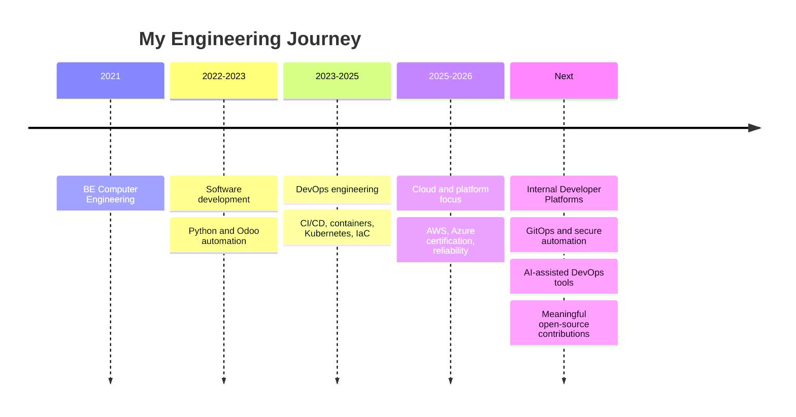

<div align="center">


[](https://www.linkedin.com/in/yash-rathod14/)
[](https://github.com/yash30389)
[](https://github.com/yash30389?tab=repositories)

</div>

---

## `root@yash:~$ whoami`

I'm a **Cloud & DevOps Engineer focused on AWS and Platform Engineering**, with a background in software development. I work on cloud infrastructure, Kubernetes, Infrastructure as Code, CI/CD, observability, and security—with a long-term goal of building reliable internal developer platforms and automation that helps engineering teams move faster.

```bash
$ cat mission.txt
Build reliable systems.
Automate the repetitive.
Secure the foundation.
Make infrastructure reproducible.
Improve developer experience.
Keep learning and contributing.
```

> **Network-inspired engineering quote:** “A strong platform is like a well-designed network: every connection has a purpose, every route has a fallback, and resilience emerges from how the whole system works together.”

## 🧭 Experience journey

| Period | Journey | Focus |
|---|---|---|
| **2021** | 🎓 Computer Engineering | BE, Gandhinagar Institute of Technology |
| **Sep 2022 – Sep 2023** | 💻 Software Development — Botspot Infoware | Python, Odoo modules, business workflow automation |
| **From Oct 2023** | ⚙️ DevOps Engineering — Techanek | CI/CD, containers, Kubernetes, IaC, automation |
| **May 2025 – Dec 2025** | ☁️ DevOps Engineer — Techify Solutions Pvt. Ltd. | Cloud infrastructure and DevOps delivery |
| **Current direction** | 🚀 Platform Engineering | Reusable platforms, developer experience, cloud-native automation |

*This is a high-level career snapshot. For formal hiring, use your resume for exact employment dates, titles, and responsibilities.*

### What I bring

- AWS infrastructure across development, staging, UAT, and production environments.
- Experience with EKS/ECS, Kubernetes workloads, container platforms, and deployment automation.
- Infrastructure as Code with Terraform/OpenTofu, CloudFormation, and AWS CDK.
- CI/CD pipelines, scaling, backup/restore, monitoring, and operational reliability.
- Cloud security practices involving IAM, secrets management, Security Hub, GuardDuty, and Inspector.
- Application development foundations with Python and Odoo.

## ☁️ Tech stack

<div align="center">

</div>

| Domain | Technologies |
|---|---|
| **Cloud** | AWS, Microsoft Azure, Google Cloud |
| **Containers** | Kubernetes, Amazon EKS, Amazon ECS, Docker, Helm |
| **Infrastructure as Code** | Terraform, OpenTofu, CloudFormation, AWS CDK |
| **CI/CD** | GitHub Actions, Jenkins, GitLab CI, Bitbucket Pipelines |
| **Observability** | Prometheus, Grafana, Jaeger, Kiali |
| **Cloud security** | IAM, Security Hub, GuardDuty, Inspector, secrets management |
| **Automation** | Python, Bash, Ansible |
| **Platform engineering** | Reusable infrastructure, deployment workflows, reliability, developer productivity |

## 🚀 Selected projects

Projects below reflect areas I have worked on or explored. Follow each repository's README for its current implementation and setup instructions.

| Project | What it demonstrates |
|---|---|
| [AWS ECS Service Connect](https://github.com/yash30389/AWS-ECS-Service-Connect) | ECS service connectivity and container networking |
| [ECR Image Backup to S3](https://github.com/yash30389/AWS-ECR-Image-Backup-to-S3-Script) | Container image backup automation using AWS services |
| [Terraform State Locking with Amazon S3](https://github.com/yash30389/Terraform-State-Locking-with-Amazon-S3) | Safer Terraform state management |
| [Kubernetes Crossplane](https://github.com/yash30389/Kubernetes-Crossplane) | Kubernetes and cloud-native infrastructure exploration |
| [GCP Terraform](https://github.com/yash30389/GCP-Terraform) | Infrastructure as Code for Google Cloud |
| [ablo-orchestrator](https://github.com/yash30389/ablo-orchestrator) | Orchestration project; check its README for current implementation status |

## 🧪 Hobby projects & labs

My lab work is where I test ideas, learn unfamiliar tools, and turn concepts into reproducible examples.

- **Kubernetes playground:** local clusters, deployments, services, ingress, and operational experiments.
- **GitOps and platform engineering experiments:** exploring reusable workflows, self-service patterns, and deployment automation.
- **Infrastructure modules:** practicing repeatable cloud resources, configuration validation, and safe state management.
- **AI-assisted DevOps concepts:** exploring AI for infrastructure analysis and engineering workflows with security and human review.

These are areas of exploration, not claims that each is a separately released product. Browse my [repositories](https://github.com/yash30389?tab=repositories) for code and project status.

## 📈 【Ｓｔａｔｓ】 & development metrics

<div align="center">


</div>

### Contribution calendar

<div align="center">

</div>

### WakaTime coding activity

WakaTime can show coding time and language breakdowns after your editor is configured to report activity to your account.

1. Create/configure your account at [WakaTime](https://wakatime.com/).
2. Install its editor extension and enable tracking.
3. Add your public share/embed URL here when ready.

<!-- TODO: Add your WakaTime public share/embed card after setup. Never publish an API key. -->

<sub>GitHub stats, language cards, activity graphs, contribution calendars, and view counters rely on external services. They may be delayed or unavailable and are not guaranteed real-time impression analytics.</sub>

## 🏅 Certificates & achievements

- **Microsoft Certified: Azure Administrator Associate** — cloud administration, identity, networking, governance, and operational management.

### Learning achievements & next certifications

- **AWS AI Practitioner** — an area of interest for foundational AI knowledge.
- **AWS Solutions Architect – Professional** — a future goal as AWS architecture skills deepen.
- **Kubernetes and platform engineering** — ongoing hands-on learning in cluster operations, GitOps, reliability, and developer platforms.
- **Go and Python automation** — improving the ability to build maintainable engineering tools.

*Only the Azure certification above is listed as earned. The other items are learning goals, not completed certifications.*

## 🗺️ Roadmap — next milestones



> Roadmap items describe direction and learning priorities, not promised delivery dates.

## 🔐 Engineering principles

```yaml
engineering:
  infrastructure: reproducible
  access: least-privilege
  delivery: automated-and-tested
  reliability: observable-and-recoverable
  documentation: part-of-the-work
  collaboration: respectful-and-open
  learning: continuous
```

## 🌱 Open source

I'm especially interested in contributing to:

- AWS and cloud infrastructure tooling
- Kubernetes and cloud-native platforms
- Terraform/OpenTofu and infrastructure automation
- CI/CD, observability, reliability, and cloud security
- Developer tooling and AI-assisted engineering workflows

I value clear documentation, reproducible examples, automated tests, useful bug reports, and thoughtful code review.

## ☕ Support my work

If you find my open-source work useful, a ⭐ star, issue report, constructive feedback, or contribution is always appreciated.

<!-- Optional: create your own Buy Me a Coffee page, replace YOUR_USERNAME, then uncomment the button. Never use another person's donation link. -->
<!-- <a href="https://www.buymeacoffee.com/YOUR_USERNAME"></a> -->

## 🤝 Connect

- **GitHub:** [@yash30389](https://github.com/yash30389)
- **LinkedIn:** [yash-rathod14](https://www.linkedin.com/in/yash-rathod14/)

<div align="center">


**“In a resilient network, no single node tells the story; reliability lives in the connections.”**

*Automate the repetitive. Secure the foundation. Build what matters.*
</div>
